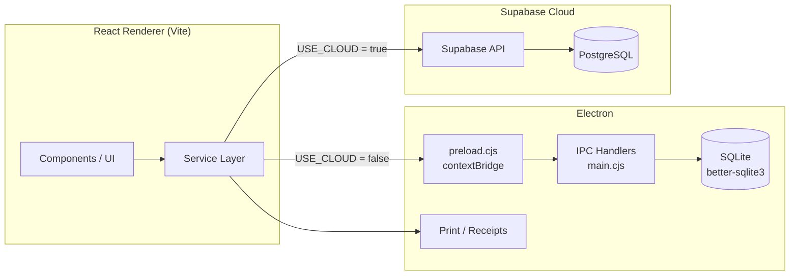

# Architecture — Bookstore Order Manager

## Overview

Bookstore Order Manager is an Electron desktop application with a React + TypeScript renderer. The renderer is isolated from Node.js: `preload.cjs` exposes a minimal `window.electron` API through `contextBridge`, and the main process handles SQLite queries and printing over IPC.

Data access is abstracted behind a service layer. `USE_CLOUD` in `services/config.ts` selects between:

- **Cloud mode (default):** Supabase (PostgreSQL) through `@supabase/supabase-js`.
- **Local mode:** SQLite through `better-sqlite3` in the Electron main process.

## Diagram



## Layers

| Layer | Responsibility |
|---|---|
| `components/` | UI, forms, tables, reports, modals |
| `services/` | Data access, PDF/Excel export, caching, error handling |
| `App.tsx` | App shell and data refresh |
| `main.cjs` | Electron window, SQLite initialization, IPC, printing |
| `preload.cjs` | Minimal, explicit bridge between renderer and main process |
| `supabase_schema.sql` | Database schema for cloud mode |

## Data modes

`services/config.ts`:

```ts
export const USE_CLOUD = true;
```

- `true` → orders, customers, and reference data go through Supabase.
- `false` → the same service functions use SQLite via `window.electron.db`.

The UI does not know which mode is active; it calls the same exported functions.

## Security boundaries

- The renderer has no direct `require` / Node.js access (`contextIsolation: true`, `nodeIntegration: false`).
- Only whitelisted IPC channels are exposed by `preload.cjs`.
- Supabase credentials come from `VITE_*` environment variables; no keys are committed.
- `VITE_ADMIN_PASSWORD` is a local UI gate, not authentication.
- Production deployments must enable Row Level Security (RLS) and proper policies.

## Report generation

- `services/order-pdf.ts` and `services/receipt-pdf.ts` build PDFs with jsPDF.
- `services/order-export.ts` exports Excel workbooks with xlsx.
- `components/templates/` contains printable HTML templates used for thermal receipts and reports.

## Known limitations

- Windows is the primary packaging target (`electron-builder --win`).
- The admin gate is client-side only; it is not a replacement for real authentication.
- Cloud mode requires a Supabase project and the schema in `supabase_schema.sql`.
